  
   
  
  

    
    
    
  

## About me

I'm a software engineer based in Bangladesh, with experience developing full-stack web applications and business management systems. Much of my work involves understanding business requirements and translating them into working features — from database models and backend logic to user interfaces and reports.

My academic background is in Computer Science and Engineering, with research experience in deep learning for medical imaging. I'm interested in applying AI to practical problems and currently developing my understanding of NLP, transformers and large language models.

## Professional experience

### Software Engineer — C&E IT Solutions

- Worked on enterprise applications for HR and payroll, hospitals, academic institutions, inventory and distribution.
- Implemented business workflows, validation rules, role-based access and approval processes.
- Developed database queries, reports and Excel import/export features.
- Maintained existing applications, investigated bugs and implemented fixes.

**Technologies:** C#, ASP.NET MVC, Entity Framework, SQL Server, Razor, JavaScript and jQuery.

### Senior Software Engineer — SoftMariyam

- Worked on a cloud-based hotel and restaurant management application.
- Contributed to modules for reservations, check-in/check-out, restaurant operations and accounting.
- Worked across the frontend, backend and database to implement and maintain application features.

**Technologies:** React, Node.js and MongoDB.

## Engineering focus

| Area | What I work on |
|---|---|
| Full-stack development | Web interfaces, backend APIs, database integration and application features |
| Business workflows | ERP modules, form validation, permissions, approvals and operational rules |
| Data & reporting | Relational and document databases, queries, reports and spreadsheet import/export |
| Application maintenance | Debugging, feature improvements, testing and deployment preparation |
| Personal projects | Building and refining management applications for education, healthcare, libraries and retail |

## Technologies I've used

  
  
  
  
   
  
  
  
  
  
   
  
  
  
  
   
  
  
  
  

My professional experience includes .NET and JavaScript-based application development. I've also used newer web technologies and Docker in personal projects and deployment preparation, and Python in my AI learning and research.

## Selected public projects

| Project | Overview |
|---|---|
| [**ShopApp**](https://github.com/tanviranjum1/ShopApp) | Full-stack electronics e-commerce application using React, Redux, Node.js and MongoDB. |
| [**DevConnect**](https://github.com/tanviranjum1/developersApp) | Developer community application featuring profiles, posts and a developer directory. |
| [**Share Places**](https://github.com/tanviranjum1/Share-Places) | Application for sharing places, images and locations through interactive maps. |
| [**Doctor Appointment System**](https://github.com/tanviranjum1/Doctor-Appointment-System) | Appointment scheduling application with doctor listings, patient booking and administrative functionality. |

I also work on management applications for schools, hospitals, libraries and retail businesses. Some of these projects are in private repositories and are not linked here.

## Education & research

**BSc in Computer Science and Engineering** · Leading University, Bangladesh · 2022  
**CGPA: 3.93 / 4.00**

My undergraduate research focused on using convolutional neural networks to detect COVID-19 from chest X-ray images. I was the first author of a paper presented at the IEEE CCWC 2022 conference.

### Currently learning and exploring

- Natural language processing, transformers and large language models
- Trustworthy AI, AI security and detection of AI-generated content
- Practical AI applications for education, healthcare and safer online interactions
- Improving software architecture, testing and deployment practices

These are areas I'm developing further, rather than claims of specialist expertise.

## GitHub activity

  

Some professional and personal work is maintained in private repositories.

---

  <strong>Thanks for visiting.</strong> 
  I'm happy to connect with people interested in software engineering and applied AI.
    
  <a href="https://www.linkedin.com/in/tanvir-anjum111/">LinkedIn</a> ·
  <a href="mailto:anz.tanvir@gmail.com">Email</a> ·
  <a href="https://github.com/tanviranjum1?tab=repositories">Repositories</a>

